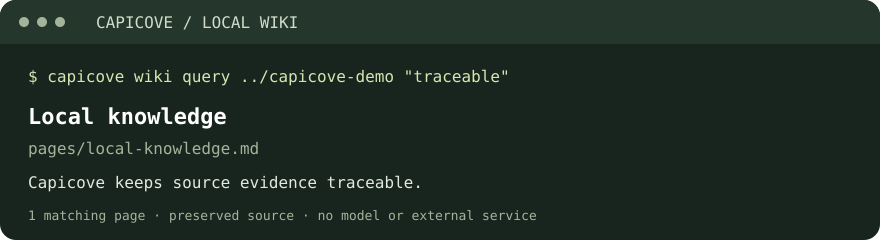
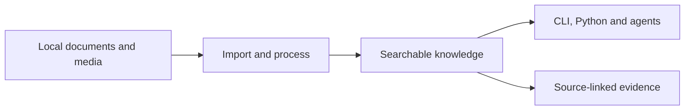

<p align="center">
  
</p>

<p align="center">
  <strong>A local-first second brain for humans and AI agents.</strong>
</p>

<p align="center">
  Turn documents, media, and agent experience into searchable knowledge,<br/>
  traceable answers, and skills you can review and improve.
</p>

<p align="center">
  <a href="https://github.com/happyBayes/capicove/actions/workflows/ci.yml?query=branch%3Amain"></a>
  <a href="LICENSE"></a>
  <a href="pyproject.toml"></a>
  <a href="https://capicove.readthedocs.io/"></a>
</p>

<p align="center">
  <a href="#what-you-can-build">Highlights</a> ·
  <a href="#quickstart">Quickstart</a> ·
  <a href="#connect-your-agent">Agent integration</a> ·
  <a href="docs/site/index.md">Documentation</a> ·
  <a href="ROADMAP.md">Roadmap</a> ·
  <a href="CHANGELOG.md">Changelog</a>
</p>

Capicove turns local documents and media into searchable knowledge with a path
back to the source. Build a research library, give an agent lasting context, or
turn reviewed task feedback into reusable skills. Your files, permissions and
history stay under your control.

> **0.1.0 · First public source release · October 25, 2026.** Start from the
> checkout below. Package-index publication is tracked separately in
> [package status](docs/site/getting-started/release-status.md).
> Preview and experimental work is listed in the [roadmap](ROADMAP.md#coming-soon).

## Quickstart

Requires **Python 3.11+** and [uv](https://docs.astral.sh/uv/). From a source
checkout, install the Wiki extra:

```bash
git clone https://github.com/happyBayes/capicove.git
cd capicove
uv sync --locked --extra wiki
uv run --no-sync capicove doctor
```

Dependency installation may access the network. This example runs offline after
installation, without model downloads or external services.

### Build a searchable local Wiki

This shell example creates a new workspace outside the repository and a sample
note. Choose an unused workspace path:

```bash
mkdir -p ../capicove-demo/notes
printf '# Local knowledge\n\nCapicove keeps source evidence traceable.\n' \
  > ../capicove-demo/notes/welcome.md
uv run --no-sync capicove wiki init ../capicove-demo
uv run --no-sync capicove wiki ingest ../capicove-demo ../capicove-demo/notes/welcome.md
uv run --no-sync capicove wiki lint ../capicove-demo
uv run --no-sync capicove wiki build ../capicove-demo
uv run --no-sync capicove wiki query ../capicove-demo "traceable"
```

The query returns matching pages from the local lexical index. Inspect the
Markdown under `../capicove-demo/wiki/pages/` and preserved source snapshots under
`../capicove-demo/wiki/raw/`. No LLM or database server is required.



*Selected fields from the quickstart's JSON output, arranged for readability.*

## What you can build

| Workflow | What you get | Start here |
| --- | --- | --- |
| **Evidence-backed knowledge** | Import, search, cited answers, source updates and revocation | [Native knowledge](docs/site/guides/native-knowledge.md) |
| **A readable local Wiki** | Markdown pages, preserved sources and rebuildable search | [Local Wiki](docs/site/guides/local-wiki.md) |
| **PDF book reading** | Page-aware parsing, chapters and agent-assisted summaries with block citations | [PDF books](docs/site/guides/pdf-book-fast-reading.md) |
| **Multimodal processing** | Image filtering and OCR, audio transcription and clipping, video splitting and deduplication | [Image](docs/site/guides/image/overview.md) · [Audio](docs/site/guides/audio/overview.md) · [Video](docs/site/guides/video/overview.md) |
| **Persistent agent context** | Scoped episodes and time-aware facts linked to immutable evidence | [Temporal Memory](docs/site/guides/temporal-memory.md) |
| **Reviewed skill evolution** | Versioned skills, candidate evaluation, explicit activation and rollback | [Skill evolution](docs/site/guides/skill-evolution.md) |
| **Repeatable processing** | Resumable batches, checkpoints, retries and content-based cache reuse | [Directory batches](docs/site/guides/directory-batches.md) |

### From source to evidence



Source snapshots, hashes and lineage remain separate from rebuildable indexes.
In the native knowledge workspace, OCR and transcription make media searchable;
video coverage uses sampled frame OCR. Text-only mode returns evidence. Generated
answers require an explicitly configured endpoint, with citation IDs and exact
quotations checked before claims are returned. Traceability still requires human
judgment about what the evidence supports.

### Start small, add what you need

- **Local first.** No cloud account is needed for local workflows. Model downloads,
  external endpoints and telemetry require explicit opt-in.
- **Optional models and services.** Provision verified assets for OCR, embeddings,
  reranking, transcription and generation. [Model services](docs/site/guides/model-services.md)
  provide shared HTTP access to configured capabilities.
- **Replaceable backends.** Companion plugins add PaddleOCR, FAISS, Elasticsearch,
  OpenSearch and Spark without making them requirements for every workflow.

Requirements vary by capability: native knowledge requires Linux; Skill evolution
requires Linux or macOS; Temporal Memory needs SQLite 3.42+ with FTS5. Model and
media workflows also need their selected runtimes and assets. See the
[capability matrix](docs/site/getting-started/capabilities.md),
[installation options](docs/site/getting-started/optional-dependencies.md) and
[offline deployment guide](docs/site/guides/deployment.md).

## Connect your agent

Install the MCP extra, then create a private workspace at a new absolute path:

```bash
uv sync --locked --extra wiki --extra mcp
uv run --no-sync capicove setup init /absolute/private-workspace
uv run --no-sync capicove mcp catalog --config /absolute/private-workspace/host.json
uv run --no-sync capicove mcp serve --config /absolute/private-workspace/host.json
```

Configure your MCP client to launch the final command from the checkout, using
absolute executable and configuration paths as needed. The starter configuration
exposes only a read-only image shape tool. Add authorized source roots and
selected capabilities using the [MCP guide](docs/site/guides/mcp-stdio.md).

For an evidence-backed knowledge agent on Linux, `capicove kb init` creates a
knowledge workspace and its own `host.json`. That host exposes status, search,
ask, and evidence tools; source updates stay in the operator CLI. Follow the
[native knowledge guide](docs/site/guides/native-knowledge.md) for a complete setup.

Local MCP uses stdio. The separate workspace HTTP host listens on loopback only.
Remote MCP is a controlled preview; see [Coming soon](ROADMAP.md#coming-soon)
and [known limitations](docs/site/reference/known-limitations.md).

## Explore and contribute

[Documentation](docs/site/index.md) · [Roadmap](ROADMAP.md) ·
[Changelog](CHANGELOG.md) ·
[Privacy and network behavior](docs/site/reference/privacy-and-network.md)

Bug reports, documentation improvements, adapters and reproducible evaluation
cases are welcome. Read [Contributing](CONTRIBUTING.md), [Governance](GOVERNANCE.md)
and the [Code of Conduct](CODE_OF_CONDUCT.md).

```bash
uv sync --locked --group dev
make quality
make test
make build
```

Preview the documentation with `make docs-serve`; validate it with `make docs-check`.
Report vulnerabilities through [Security](SECURITY.md).
Capicove is licensed under the [MIT License](LICENSE).
