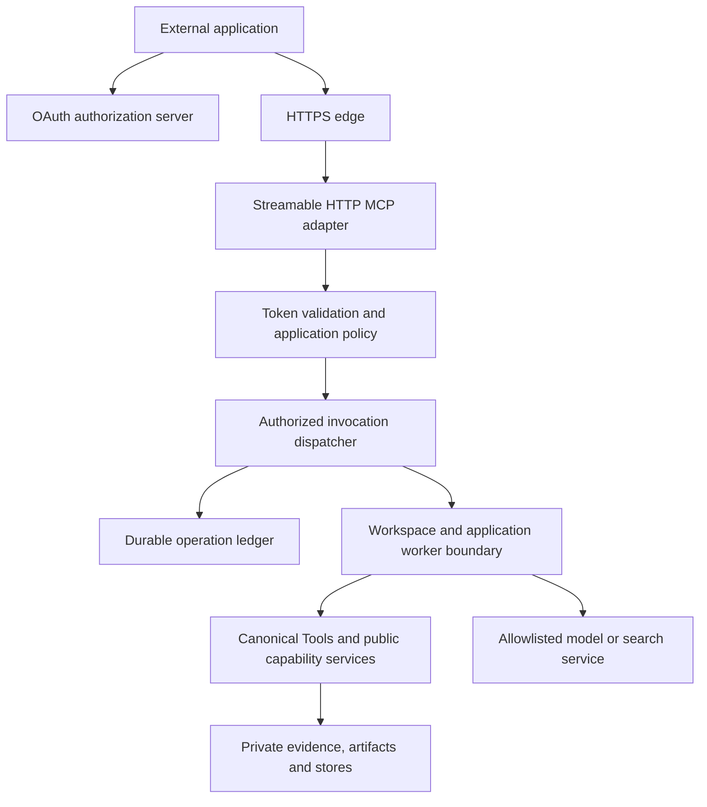

# RFC-0028: Authenticated remote MCP and complete capability coverage

- Status: Accepted for implementation by requester direction on 2026-10-22; not production-qualified
- Date: 2026-10-22
- Requested outcome: Linux deployment, Streamable HTTP, application authentication,
  authorization isolation, and production qualification of every supported capability.
- Identity decision: The requester selected a replaceable OAuth/OIDC integration.
- Baseline: `d63f946d8e265f5c7f0e335e2ba4ec306dfd6c2c`, with pre-existing working-tree
  changes. This is a source inspection, not a clean release qualification.
- Proposed decision: [ADR-0032](../adr/0032-remote-mcp-isolated-execution.md).
- Coverage and delivery gates: [Remote MCP capability coverage](../development/remote-mcp-capability-coverage.md).
- Review revision: 2026-10-22, source `bbec8d4200b6cbc80aab5b05684c23791296eefb`
  with concurrent unrelated changes; findings and closure are recorded in the
  companion document. Implementation was subsequently authorized as recorded below.

## 1. Outcome and acceptance boundary

An authorized external application connects to one HTTPS MCP endpoint, discovers
only its allowed Tools, submits work, and retrieves authorized evidence and
artifacts without knowing server filesystem paths. Every supported Capicove
business operation has a bounded, versioned MCP contract and a passing Linux
installed-wheel journey. Administrative operations are reachable through a
separate administrative MCP endpoint and explicit grants; ordinary applications
do not acquire administrative authority by discovering the service.

"All capabilities" means the supported public operations in the release's frozen
inventory, including optional providers and existing CLI/Python-only operations.
An early transport release is an incomplete milestone, not completion of this
request. Missing providers, unavailable models, unqualified parsers, or an
unimplemented Tool remain visible release blockers for the affected profile.
Internal helpers, launching daemons, installing arbitrary Python packages, and
running arbitrary shell/code are not business Tools. Equivalent service lifecycle
operations stay with the Linux supervisor. These classifications require review;
they cannot be used to silently discard a business capability.

Production qualification applies to an identified release, provider set, Linux
image, hardware envelope, identity provider, and tested client versions. It is not
a claim that every third-party plugin or future client works automatically.

## 2. Verified starting point

| Source | Existing behavior | Required change |
| --- | --- | --- |
| `src/capicove/cli/commands/mcp.py`, `mcp/server.py` | Configured stdio; closed Tool catalog; four concurrent synchronous handlers | Add a separate remote transport; retain stdio behavior |
| `src/capicove/mcp/bindings.py` | Canonical schema validation, decoding, invocation, tracing, result identity checks | Reuse this path with an explicit verified invocation context |
| `src/capicove/runtime/mcp_host.py` | Process-owned workspace, actor, permissions, roots and factories | Separate immutable composition from per-request authority |
| `src/capicove/runtime/knowledge_mcp.py` | Four query Tools; handler checks configured actor identity | Explicitly adapt checks to verified request authority, not ambient mutable identity |
| `src/capicove/api/workspace.py`, `workspace_server.py` | Linux loopback REST, per-start shared token, one active invocation, worker process lifecycle | Reuse lifecycle principles; do not expose this REST listener as MCP |
| `src/capicove/runtime/*_mcp.py` | Selected image, memory, retrieval, media, jobs, traces, models, knowledge | Complete capability compositions and remote-safe I/O |
| `pyproject.toml`, `uv.lock` | MCP optional dependency `>=1.30,<2`; lock contains 1.30.0 | Qualify an exact SDK version; no implicit SDK major upgrade |

The older CLI/MCP inventory contains historical statements. The companion coverage
document reconciles current source rather than treating those statements as a
current release verdict. Existing acceptance reports are historical evidence;
this proposal does not claim to have repeated their Linux runs.

## 3. Alternatives and decision

| Approach | Advantage | Limitation | Decision |
| --- | --- | --- | --- |
| HTTPS proxy in front of current REST | Small deployment change | Not MCP; shared startup identity; incomplete capability coverage | Useful only for existing REST consumers |
| Generic stdio-to-HTTP bridge per application | Reuses local process entry immediately | Adds a second policy layer; artifact/job/security semantics still missing | Temporary trusted integration only; not the target architecture |
| Native remote MCP adapter over shared Tools and isolated workers | One domain implementation; enforceable identity and complete coverage | Requires auth, job/artifact contracts and qualification | Selected |

Keep the modular monolith and public capability ports. Do not introduce a separate
implementation of search, knowledge, parsing, or model inference in the gateway.

## 4. Components and dependency boundaries



Proposed ownership (paths describe future implementation, not existing files):

- `capicove.contracts.remote`: immutable `Principal`, `AuthorizationDecision`,
  `AuthorizedInvocation`, `ArtifactRef`, `OperationRef`, `ApprovalRef` values and
  port protocols. Standard-library dependencies; no HTTP, MCP, DB or JWT imports.
- `capicove.runtime.remote_policy`: application/workspace mapping, resource grants,
  live policy revision and grant revocation. Deny by default.
- `capicove.runtime.remote_dispatch`: enforce policy, resolve opaque inputs,
  reserve quotas, create contexts, dispatch and recheck output authorization.
- `capicove.mcp.remote`: MCP lifecycle, method routing, discovery and result
  projection only. Uses the qualified official SDK's transport implementation.
- `capicove.runtime.remote_workers`: private authenticated IPC, supervision,
  scheduling, deadlines, cancellation and ownership fences.
- `capicove.runtime.remote_operations` and `remote_artifacts`: application services
  over persistence/blob ports; private adapters own SQLite and filesystem details.
- `capicove.runtime.<capability>_mcp`: capability composition using public APIs;
  add missing adapters after their contract is accepted.

Do not make a capability import the remote gateway. Move reusable process-control
code behind a public runtime API instead of importing private HTTP server helpers.
Optional dependencies remain lazy and a new `remote-mcp` extra selects the tested
SDK, ASGI, token validation and schema dependencies.

### Invocation authority

The transport validates credentials and produces an immutable principal:
`issuer`, `subject`, `client_id`, `application_id`, `tenant_id`, `token_id_hash`,
`expires_at`, `grant_id`, `scopes`, `authentication_method`. Issuer-specific claim
mapping is configured and validated; an arbitrary `sub` string is never assumed
to be an application ID. No raw token enters a Tool, trace, job record or worker.

Define `PrincipalKey = (issuer, tenant_id, application_id, subject_kind, subject)`.
`subject_kind` distinguishes a service principal from a delegated human. Define
`AuthorityKey = (PrincipalKey, workspace_binding_id, grant_id, audience)`.
Tenant/application/grant mappings come from the operator's enrollment registry,
using validated issuer-specific claims; self-registration or a token claim alone
cannot assign an existing tenant. Missing or conflicting client/authorized-party
claims fail closed. The AS integration must demonstrate how the access token binds
both client and subject. The grant is a server-owned record, not a caller role.
`token_id_hash` is an audit reference; a missing JWT `jti` uses a keyed digest of
the credential, never the raw credential or an unkeyed reusable identifier.

`AuthorizedInvocation` contains the principal reference, workspace binding,
effective permissions, policy revision, authorized resource selectors, Tool
ID/version, request/trace IDs, deadline, input digest and optional approval.
The trusted dispatcher constructs `InvocationContext`; caller arguments and MCP
metadata cannot override it. Existing stdio context factories remain unchanged.
Remote invocation supplies context explicitly through a shared invocation API;
it never mutates a shared binding's `context_factory` between requests.

Capability checks against a fixed actor (notably knowledge) must be migrated to
verify the dispatcher-issued workspace/application binding and resource policy.
Any legacy service that still requires one actor receives a dedicated binding
for that principal. Shared mutable actor state is prohibited, including across
thread pools and asynchronous callbacks. Worker IPC validates an invocation
against its pinned workspace, grant, Tool catalog and policy generation.

Private IPC authenticates worker/supervisor peers by OS credentials and an
instance-bound channel. Invocation envelopes bind worker instance, nonce,
AuthorityKey, lease/fence, catalog digest and input digest; stale or duplicate
dispatch cannot acquire another effect lease. Use bounded typed serialization,
not pickle or caller-supplied Python objects. A worker cannot request arbitrary
new mounts, secrets, commands or policy changes through this channel.

## 5. MCP transport and client compatibility

Propose `capicove mcp serve-http --config /etc/capicove/remote.json` as a new
command. It does not exist yet. `mcp serve` continues to mean local stdio.
`http serve` retains its accepted loopback REST contract.

Freeze the first compatibility target at MCP `2025-11-25`; test SDK 1.30.0 before
selecting its release pin. Upgrade the target only through a documented protocol
compatibility review. Do not copy examples from newer SDK majors into this branch.

The application endpoint is `https://mcp.example.org/mcp`; the privileged endpoint
is `https://mcp-admin.example.org/mcp`, with a different audience and grant set.
One MCP endpoint supports POST requests and GET SSE; DELETE terminates a session.
Use JSON responses for bounded calls and POST SSE for progress-capable calls.
Accepted notifications return 202. Negotiate protocol versions during initialize,
validate subsequent version/content-type/Accept headers, and reject unsupported
versions with 400. Legacy HTTP+SSE transport is not part of this profile.
These behaviors follow the [versioned transport specification][transport].

Start with stateful, bounded sessions owned by one gateway process. Session IDs
are random opaque values, bound to issuer, subject, application, grant, workspace,
audience, negotiated protocol and policy revision. A session is not a credential:
authenticate every POST, GET and DELETE. Missing required session IDs return 400;
expired or unknown sessions return 404; a valid credential from another principal
cannot adopt a session. Token refresh may reuse a session only for the same
identity and binding; policy changes invalidate affected sessions. Defaults:
15-minute idle expiry, 8-hour maximum lifetime, 10 sessions per application.

The binding includes `subject_kind` and the complete AuthorityKey. Each refreshed
token is revalidated and its scopes intersected with current authority; refreshing
does not widen a session's original ceiling. A scope increase requires a new
session. Account/tenant switching always initializes a new session. Requests in
one session have unique active JSON-RPC IDs, scoped by session plus AuthorityKey;
request IDs, progress tokens and cancellation IDs are not global lookup keys.

SSE queues are bounded (128 events or 1 MiB per session); disconnect slow consumers.
The first release makes no SSE replay guarantee and emits no resumable event IDs.
After disconnect, clients use durable operation status/results; reconnecting does
not repeat mutations. Gateway restart invalidates sessions but preserves admitted
operations. Concurrent reads and calls still use per-request authorization.
Cancellation notifications address only the authenticated principal's request.
Closing a stream or session is not evidence that work was cancelled.

An open SSE stream must close at access-token expiry or grant revocation, even
without another client request. Reconnection requires a current credential and
the same authorized binding. Session lifetime does not extend token lifetime.

`tools/list` is filtered by application, workspace, permission and provider
readiness, with deterministic pagination. A cursor binds the principal, policy
revision and catalog digest. Reauthorize `tools/call` even for a name previously
listed. Advertise only implemented MCP capabilities; no sampling, elicitation,
prompts, MCP task extension or resumability claim until separately tested.

Origin validation rejects unapproved browser origins; absent Origin is allowed
for authenticated server clients. Validate Host and the configured public URL.
Only an allowlisted local reverse proxy may supply forwarded headers. CORS is
disabled unless exact browser origins, methods and headers are configured;
credentials never use wildcard origins. Rejection precedes Tool execution.

| Failure | Wire behavior |
| --- | --- |
| Missing/invalid/expired credential | HTTP 401 with discovery challenge; no Tool dispatch |
| Valid credential with insufficient scope | HTTP 403 with a bounded scope challenge |
| Malformed protocol envelope | SDK-compatible JSON-RPC parse/invalid-request error, or transport 400 where required |
| Unknown or ungranted Tool | Indistinguishable sanitized unavailable-Tool error; do not disclose hidden catalog entries |
| Canonical domain failure | MCP `CallToolResult.isError=true` and the validated canonical failed/rejected envelope |
| Admission quota exceeded | HTTP 429 with Retry-After before work admission; retry mutations only with the original idempotency key |
| Tool execution timeout | Failed/rejected Tool envelope for synchronous work; durable terminal/unknown state for operations |
| Service draining or unavailable | HTTP 503 before admission; admitted operations remain queryable after recovery |

The hidden-Tool rule takes precedence over scope guidance: unknown and ungranted
Tool names both receive the same JSON-RPC invalid-params error without a scope
list. HTTP 403 scope challenges apply to known, grant-visible operations only.
Check authentication before parsing domain inputs and check catalog visibility
before evaluating private object IDs. For permitted Tools, schema-invalid
arguments are a protocol error; actual domain execution failures use `isError`.
This split follows the [Tools error model][tools-spec].

The dispatcher must preserve canonical failure evidence while the MCP projection
sets `isError`; returning an arbitrary result dictionary is not sufficient proof
of correct error semantics. Never expose stack traces, provider secrets or host
paths. Grant-specific errors must not disclose another tenant's object existence.

Pin catalog and schemas for the session; a policy/catalog change invalidates its
cursors and requires reinitialization. Temporary provider failure returns a
sanitized unavailable result and private readiness alarm, not a silent catalog
downgrade. No list-change capability is advertised in this initial pinned profile.
One wire name resolves to one canonical ID/version/schema digest. Legacy names
remain attached to their existing contracts; incompatible remote wrappers get
distinct version-suffixed names (for example `capicove_image_filter_shape_v2`)
and explicit canonical mappings. Never choose a schema version from caller metadata
or silently replace the schema of an existing name.

## 6. Replaceable OAuth/OIDC integration

Capicove is an OAuth resource server, not a home-built identity provider. Publish
Protected Resource Metadata and a `WWW-Authenticate` discovery challenge. Use a
configured authorization server with its discovery metadata; OIDC can supply
identity integration, but an OIDC ID token is not an MCP access token. Audience
binding and metadata discovery follow the [authorization specification][auth].

Support two qualified client paths:

1. Backend applications obtain short-lived access tokens using client credentials
   from the configured authorization server. Prefer registered key assertions;
   securely stored client secrets are a compatibility option. The MCP client
   credentials extension is optional and independently versioned; do not claim
   universal client support. Record exact tested client/extension versions.
2. Interactive applications use authorization code with PKCE and user consent at
   the identity provider. Both application grants and delegated user grants must
   allow the operation. Administrative approval requires this human identity.

The [official client-credentials guidance][client-credentials] describes the first
path. A small integration example may acquire a token explicitly when an MCP
client lacks extension support; it must not silently switch to a shared API key.
The production default does not accept static shared bearer secrets.
Accept credentials only through one well-formed Authorization bearer header;
reject duplicate headers, query-string tokens and cookie-based fallback. Public
metadata exposes only configured issuer/resource information, never application
registrations or private profile paths. PKCE redirect/consent/client-registration
behavior belongs to the authorization server, with integration tests for exact
redirect URI validation, state/issuer mix-up and no open redirect.

The verifier port supports JWT/JWKS and opaque-token introspection adapters.
For JWTs, validate allowed algorithm, signature, issuer, audience, expiry,
not-before, required principal claims and grant binding. Reject `none`, algorithm
confusion, unknown issuers and arbitrary token-supplied JWKS URLs. Key refresh is
bounded, rate-limited and restricted to configured endpoints; unknown keys fail
closed. Introspection uses a private configured credential and validates active
status, intended audience and expiry. Access tokens never pass through to LLM,
search, storage or other downstream services.

Defaults are a five-minute access-token lifetime and 30-second clock skew.
Application/subject/grant denial is checked locally on every admission, execution
start, artifact read and result release. Gateway policy generations are distributed
within five seconds; failure to refresh a required generation rejects new work.
Offline JWT validation alone cannot guarantee immediate identity-provider logout:
without a revocation event or introspection it is bounded by token expiry plus
skew. Admin operations require fresh introspection or equivalent signed revocation
state. Document this distinction and test both modes.

Enforce a maximum accepted token age/lifetime instead of assuming the external AS
honors the five-minute default. Check issuer-specific `iat`/expiry policy and
required claims; integrations unable to meet it require online validation, not
an undocumented longer revocation bound. Cache positive introspection for at most
five seconds and never past expiry; admin approval/execution requires uncached
validation. Introspection timeout is two seconds, with no stale-success fallback.
Record the precise bound for each verifier mode in the deployment receipt.

Only configured HTTPS issuer/metadata/JWKS/introspection endpoints are reachable;
resolve and validate destinations, deny redirects outside the allowlist, and block
cloud metadata/link-local/private destinations unless an exact private identity
endpoint is operator-approved. Disallow token-provided discovery URLs. Token size,
JSON depth and refresh attempts are bounded before cryptographic work. Replacing
the identity provider means qualifying a claim mapping and token profile, not just
changing a URL. Pre-registered clients are the initial supported enrollment mode;
dynamic registration and client-metadata fetches are not silently enabled.

Bearer access tokens can be replayed by someone who steals them within their
validity period; session binding does not prevent that. TLS, secret storage,
short lifetime and revocation bound the risk, but do not establish proof of
possession. The admin profile additionally requires an allowed recent MFA
authentication context (maximum age five minutes); a client incapable of the
required step-up cannot approve. Deployments requiring sender-constrained tokens
must qualify mTLS/DPoP as an additional profile before claiming that protection.

Revocation prevents new calls, queued starts and result retrieval, terminates
streams and requests cancellation of running work. Work already sent to an
external model cannot be recalled. Store a truthful cancellation or unknown-outcome
receipt; never report an unobserved rollback as successful.

Separate revocation request time, durable policy commit time, and enforcement
acknowledgement. The five-second propagation target is a bound, not instantaneous
revocation. The owner of each workspace serializes policy/source epoch changes,
effect commits and output-release authorization through an admission/publication
gate. A revocation acknowledgement is emitted only after old-epoch commit/release
permits are closed or fenced. If this cannot be established within five seconds,
the workspace becomes unavailable and the operation reports an enforcement
failure rather than a successful revocation. Local/CLI source mutations must
participate in the same gate or require an exclusive maintenance window.

Checking policy once and later writing an unrelated database transaction is
insufficient. A capability must either commit under the workspace-owned gate or
stage output and use the gate to publish its durable reference. Non-transactional
external effects require pre-dispatch authority and reconciliation; they cannot
claim the local atomic revocation guarantee. Already transmitted bytes/effects
cannot be recalled. Streaming rechecks authorization before each bounded chunk;
pending queues are cleared on epoch change, and revoked content is not released
after acknowledgement. Fault tests pause execution at each boundary to prove it.

## 7. Permission and resource isolation

Effective authority is the intersection of deployment ceiling, application grant,
token scopes, delegated user grant when present, workspace policy and Tool
requirements. Approval is an additional condition, not a source of permissions.
No wildcard default grants, role-name substring matching, or caller-selected
provider configuration is permitted.

For example, an application grant can select `capicove.search` and
`capicove.get_evidence`, permissions `evidence:search` and `evidence:read`, one
workspace binding and a bounded source collection. A broad OAuth scope alone
cannot add another Tool or collection. A separate publisher grant may add exact
write Tool IDs; it still cannot approve a destructive plan. Deployment-specific
OAuth scopes map explicitly to canonical permissions and resource selectors.

Each registered application has explicit workspace bindings. Initial deployment
uses one binding per MCP endpoint/token grant; later multi-workspace selection
must resolve through registered opaque binding IDs. Raw `workspace_id`, actor IDs,
filesystem roots and provider URLs in arguments never confer authority.

| Layer | Enforcement |
| --- | --- |
| Catalog | Hide ungranted Tools, artifacts, models and configuration details |
| Invocation | Check exact Tool ID/version and permission set before dispatch |
| Resource | Authorize every source, evidence, memory scope, graph snapshot, job, trace and artifact |
| Storage | Separate tenant/workspace stores; application-owned objects default private; explicit sharing grants only |
| Execution | Dedicated worker security domain per tenant/workspace/application grant; separate scratch, UID/container and mount set |
| Network | Default deny; server-configured destinations and credentials by provider/profile |
| Output | Recheck live source/resource authority; strip private paths and unapproved trace/content fields |

Use database constraints and scoped repository methods as well as transport checks.
Every get/list/status/cancel/retry/export API must enforce ownership; an opaque ID
or a valid hash is not authorization. Cache keys include tenant, workspace,
AuthorityKey, effective permission digest, policy revision, source revision and
provider digest.
Cross-tenant caches are disabled except immutable, explicitly public model files.

All private cache/idempotency/job/artifact/pagination/progress namespaces use the
full AuthorityKey, including delegated user subject. Token rotation does not
change ownership. Two users of the same application do not share results or
jobs by default. Explicit sharing grants specify allowed subjects/applications,
resource IDs, operations, expiry and source rights; read sharing never implies
cancel, overwrite, delete or approve authority. A service principal cannot
impersonate a user by supplying a subject in arguments.

Row-level policies must apply before retrieval/fusion/reranking, aggregation,
context assembly and provider egress, not just before sending final results.
Unauthorized evidence must not enter an external prompt or influence a summary,
count, score or cached answer. Derived artifacts and summaries inherit the
intersection of contributing source permissions and the most restrictive privacy
class; only an approved declassification operation can relax that policy.

Workers cannot read another security domain's mounts, credentials or IPC socket.
A Python process boundary alone is not a sandbox. Use separate unprivileged
containers or service UIDs plus mount namespaces, cgroup limits, seccomp and
network policy. Native media subprocesses inherit the same restrictions. Mutable
models, histories and GPU caches are not shared across untrusted domains. GPU
sharing requires a separately qualified isolation profile or dedicated allocation.

Application-level worker isolation alone is insufficient for delegated users with
different readable data. Either allocate a worker domain per AuthorityKey or use
ephemeral invocation mounts containing only that call's authorized artifacts plus
a broker that enforces per-request subjects. Reusing a process requires verified
clearing of scratch, model context and caches; otherwise destroy it between domains.
Untrusted plugins are never loaded in the public gateway. Only operator-installed,
hash-pinned allowlisted plugin distributions execute inside the worker sandbox.
The supervisor consumes pre-provisioned worker profiles; it never interprets remote
arguments as service-manager commands, mount specifications or executable names.
Remote evaluation or VLM Tool definitions are data, never executable code grants.

For explicitly shared workspace data, a capability-owned storage broker or
validated storage API is required before concurrently admitting distinct worker
identities; do not grant both unrestricted filesystem access to implement sharing.
Single-owner SQLite stores keep one writer and serialized capability writes.
Sharing is not simulated by changing an `actor_id` around a global connection.

## 8. File, media, evidence and output transport

Remote clients must not submit server paths. Existing path-based Tools keep their
local contracts; new versioned remote-facing contracts accept artifact/evidence
references and map them to confined worker paths through public capability APIs.
Do not change a schema silently based on transport. Reuse a canonical ID/version
only when the accepted schema already supports the required representation;
otherwise add a version or distinct wrapper ID and publish its mapping.

Proposed MCP Tools: `capicove.artifact.begin-upload`, `write-chunk`, `upload-status`,
`abort-upload`, `commit-upload`, `stat`, `read-chunk`, and `delete` under the same prefix. These are proposal names,
not registered Tools. The baseline supports end-to-end upload/download over MCP
without requiring a second client API. A later authenticated streaming blob API
may optimize large files without becoming the only delivery path.

- Begin specifies expected length, media type, SHA-256 and an idempotency key;
  the server atomically reserves quota and assigns a random upload ID bound to
  AuthorityKey. Repeating begin returns the same upload rather than a second quota
  reservation. Upload-status returns received chunk indices/digests only to the
  owner; abort releases an incomplete upload exactly once and cannot undo commit.
- Write accepts numbered chunks up to 256 KiB decoded, encoded for MCP JSON.
  A repeated index with the same hash is idempotent; a changed hash conflicts.
- Commit requires contiguous chunks, verifies total size/hash, scans/parses within
  limits in quarantine, then atomically publishes an immutable artifact reference.
  Partial uploads are not discoverable by processing Tools.
- Artifact references carry opaque ID, SHA-256, byte length, media type, version
  and lineage. Content hashes are integrity values, never cross-tenant locators.
- Reads are bounded and reauthorized per chunk; results can contain authenticated
  artifact references with no server paths. Export artifacts retain source ACLs.
  The baseline advertises Tool-based reads only, not MCP resource links or a
  `resources` capability. A future resources adapter must implement and test the
  same authorization before advertising those features.
- Uploads expire after 24 hours. Default limits: 1 GiB per artifact, 10 GiB stored
  per application, 2 MiB MCP request and result envelopes. Operators may provision
  larger measured profiles; no unbounded base64 media in Tool arguments.
- Reject traversal, symlinks, archive escapes, decompression bombs, misleading
  types and external-resource fetches by parsers. Public remote inputs cannot
  select fetch URLs, filesystem paths or model download locations.
  Remote VLM/document inputs use verified artifact references; embedded HTTP/file
  URLs and parser-linked external resources cannot bypass this restriction.

Existing evidence IDs remain canonical. Artifact IDs are transport handles and
must not replace source/evidence identity. Deletion, retention and source
revocation propagate to derived artifacts, indexes, result caches and exports.
Backup restore must reapply current revocation/tombstone state before serving.

Artifact admission reserves aggregate disk/inode quotas for uploads, quarantine,
derived outputs and temporary expansion, not just the final byte length. Model
inputs additionally bound decoded pixels, pages, duration, channel count and
tokens. Global and tenant limits prevent many applications bypassing per-app
quotas. Chunk/commit mutations have immutable upload/chunk keys; commit is
idempotent and races atomically with expiry/abort. Reference deletion first
tombstones access and releases storage only after active readers and retention
rules permit it. Physical deduplication never couples tenant authorization or
reveals another tenant's hash existence.

Default operation/result retention is 30 days; upload quarantine is 24 hours.
Source and business-artifact retention is an explicit workspace policy, never
inferred from operation retention. Restricted export download authorization lasts
at most 24 hours unless an approved plan says otherwise. A deletion receipt distinguishes logical
revocation, live-storage removal and backup expiry (default maximum 30 days);
retention holds are disclosed and cannot be reported as physical erasure.
Encrypt private volumes and backups; key references and restoration access are
operator-managed. Immutable provenance may retain minimal tombstones and hashes,
but must not retain erased payloads under a different artifact identifier.

## 9. Long-running work, retries and cancellation

Reuse public batch/job services where they satisfy these requirements. Generalize
their durable contracts for graph, indexing, parsing, model install, data plans
and evolution; do not assume today's fixed batch operation list supports them.
Existing canonical Tool result statuses remain `succeeded/failed/rejected`.
A successful submission returns an `OperationRef` in its result; it does not
pretend the underlying computation has succeeded.

Proposed Tools: `capicove.operation.submit`, `status`, `result`, `cancel`, `resume`.
Submission accepts only a registered bounded operation and its validated schema,
never a shell command, arbitrary module, source code or provider URL. The registry
maps operations to existing handlers/public services. Direct synchronous calls
have a 30-second ceiling; operations likely to exceed it use submit. Provider
execution deadlines are explicitly configured, with a default one-hour ceiling.

Each active operation owns its execution unit and descendant cgroup. A timeout
must not kill unrelated jobs sharing a long-lived worker. Initially admit one
active operation per worker process and use additional isolated workers for
parallel capacity; pooled providers must prove reset/cleanup before reuse.

Persist operation ID, principal/grant reference, workspace, Tool/version, normalized
input digest, artifact/evidence versions, provider/model pins, policy revision,
idempotency key, deadline, quota reservation, lease/fence, state and output refs.
Store credential references rather than secrets. Queued work reauthorizes against
the current grant at start; token expiry does not extend execution authority.
Submission grants a bounded operation lease, and revocation still applies.

State machine:

```text
accepted -> queued -> running -> succeeded | failed | cancelled | timed_out
                         |--> cancellation_requested -> cancelled | succeeded
                         |--> outcome_unknown -> reconciled terminal outcome
```

`outcome_unknown` blocks automatic retries until a capability-specific reconciler
checks durable effects. A cancellation racing a committed success returns the
observed success, not a fabricated rollback. Resume starts a linked attempt from
a verified checkpoint, with fresh authorization and compatible provider pins.
Failures and partial artifacts remain quarantined with receipts.

Accepted/queued operations may also terminate as cancelled or timed_out before
execution. Grant revocation records cancelled with a sanitized policy reason;
validation failures before durable admission do not create a successful operation.
Cancellation_requested may end in failed, timed_out or outcome_unknown as well as
cancelled/succeeded. Terminal transitions are compare-and-swap and immutable;
reconciliation appends evidence and a linked resolved outcome rather than erasing
an unknown history. Recovery requeues only work known not to have started and
never blindly replays a possibly committed effect.

Every side-effecting submission requires an idempotency key scoped to AuthorityKey,
Tool ID/version and operation kind. Reserve the key and operation atomically. Same key plus same normalized input returns the same
operation; changed input returns a stable conflict. Keep keys at least seven days
and for the operation's retention period if longer. Expired keys do not imply
that a historical side effect is safe to repeat.

The exact idempotency namespace is `(AuthorityKey, target_tool_id,
target_contract_version, operation_kind, idempotency_key)`; it never omits the
delegated user. Normalize input using a versioned canonical JSON representation,
with no duplicate keys/non-finite numbers; bind immutable artifact versions,
provider/profile digest and relevant plan digest. Authorization and live source
checks run again before returning an existing result. Collision/replay cannot
return data outside the current grant even if the original owner was authorized.

`operation.submit` is not a privileged escape hatch: require both permission to
submit and permission for the exact target Tool/version, all referenced resources,
egress and any approval. Do this at admission, execution and publication. Deny
recursive submission, submitting another operation/approval/policy-control Tool,
arbitrary backend selection, and using an admin target on the application audience.
The target schema must be validated before admission; its limits still apply to
the nested request. Hidden targets receive the same unavailable response as unknown
ones, even through the generic submit Tool.

All remote business mutations and billable external effects use durable admission,
including direct named Tool wrappers. A remote mutation wrapper accepts an explicit
idempotency key in its new versioned schema and returns an OperationRef; it cannot
reuse the local synchronous schema with an invisible semantic change. Artifact
upload-control/chunk/commit and approval writes are short transactional exceptions with their own
durable idempotency records. Thus bypassing `operation.submit` does not bypass
deduplication, approvals or crash recovery. Read-only local computation can remain
synchronous; its disconnect outcome has no mutation to retry blindly.

Submission explicitly authorizes a background execution lease bounded by the
submitted deadline and original effective scopes/resource set. This lease can
outlive an access token, but never its grant's expiry/revocation or an approved
plan's execution limit. Workers recheck live AuthorityKey plus the original
ceiling; later broader grants cannot expand already queued work. Polling and
result retrieval require a fresh caller token. Cancellation from the owning
principal or separately authorized operator remains available during draining
and does not require acquiring the normal execution quota.

Workers use expiring leases and fencing tokens. Publication checks both the
current fence and live authority in the committing transaction. Capabilities
without atomic/fenced effects cannot be called retry-safe; isolate them behind
plan/execute/reconcile contracts. Do not promise global exactly-once execution.
Timeout/cancellation kills the owned cgroup/process group after a bounded grace
period and records the actual terminal or unknown state. Use fair per-application
queues; defaults are 20 queued operations and two active operations per application,
one writer per mutable workspace store and one GPU operation per assigned device.

## 10. Administration and approval

Separate three classes: read, bounded write, and privileged/destructive/external.
The admin MCP endpoint requires its own audience, explicit admin application
binding, delegated human identity for approval, and network access policy.
Owning a normal application credential is insufficient.

Destructive deletion, memory erasure, Wiki migration, model acquisition, restricted
trace export, and Skill approval/activation use plan -> review -> execute. The
plan fixes target IDs, versions, input digest, expected active pointer, policy
revision, costs/egress and expiry. A review Tool records the authenticated reviewer;
a caller-supplied `reviewer` string cannot establish approval. Automated service
principals cannot approve their own requests. Execution requires an unexpired,
single-use approval bound to the exact plan and rechecks authority atomically.

The approval ledger owns explicit `pending -> approved|rejected|expired` and
`approved -> reserved(operation_id) -> consumed|void` transitions. Reserving an
approval, reserving the idempotency key and admitting the operation occur in one
local transaction. Retrying admission returns the same operation; it cannot
consume approval twice. A crash after reservation preserves that binding for
reconciliation. Never automatically restore approval after a partial or unknown
external effect. The publishing capability verifies operation/fence/approval
binding through the workspace commit gate.

Reviewer identity is the verified human subject, not merely a different client
ID. Separate proposer and approver human subjects for privileged plans; a second
client belonging to the same person does not satisfy separation of duties. Bind
approval to immutable input/resource versions, target versions, provider/egress
and plan digest, policy revision, execution audience and expiry. Pre-start expiry
blocks execution; a started operation may finish only within its separately
approved execution lease. Approval revocation still fences publication.

Expose bounded admin plan/get/review-approve/review-reject/execute/status operations
with these exact semantics; no unrestricted `approve=true` parameter. Enrollment
and root provisioning remain operator-only. An enrolled service executor may
execute a human-approved plan on the admin audience without impersonating its
reviewer; it cannot create the human review. Preserve the review and execution
identities separately in receipts. Self-service credential rotation/revocation is
owned by the authorization server and enrollment operator, never by an ordinary
application's generic operation Tool.

Preserve RFC-0027's supervised Skill policy and comparison-and-swap publication.
This RFC does not grant automatic promotion. Preserve AGENTS.md's exact repository,
visibility, redistribution/consent, transfer scope and file allowlist requirements
for Hugging Face collaboration. An installation request cannot invent that consent.
Tools may expose planning/status before an operator grants execution authority.

Domain approvals are distinct from accepting this RFC or authorizing deployment.
Application enrollment, credential management, root provisioning and service
restart are operator control-plane responsibilities, not an unrestricted remote
configuration Tool. Bounded initialization of a preallocated business workspace
can have an administrative Tool after its capability contract is approved.

## 11. Linux deployment and operational profile

First required profile: single Linux x86-64 server, Python 3.11, pinned wheel and
dependency bundle, systemd supervision and isolated workers. Qualify Ubuntu 24.04
or a recorded equivalent image. ARM64/GPU profiles have separate evidence and
must not inherit x86-64 CPU qualification. SQLite remains on a local filesystem,
not NFS. One gateway owns sessions; a process restart is a documented reconnect,
not an advertised zero-downtime failover.

The HTTPS edge terminates TLS, preserves streaming, disables response buffering
for SSE, bounds header/body/connection sizes and restricts public routes. The
gateway binds a Unix socket or loopback only. No worker/model/debug/admin port is
published unintentionally. SSE keepalives are 15 seconds and edge idle timeout at
least 75 seconds; operation progress remains recoverable through polling.

Install immutable versioned releases beneath `/opt/capicove/releases/`; operator
configuration beneath `/etc/capicove/`; private mutable state beneath
`/var/lib/capicove/`; runtime IPC beneath `/run/capicove/`. Use owner-only config
and secret files, separate worker identities, `NoNewPrivileges`, read-only system
mounts, bounded writable mounts, private temporary directories, CPU/memory/PID/disk
quotas and constrained egress. A supervisor provisions security domains; the
public gateway does not possess a Docker socket or root credentials.

A future versioned remote configuration contains only these explicit sections:

| Section | Required contents |
| --- | --- |
| `schema_version`, `service_id` | Strict known version and stable service identity |
| `transport` | Public resource URL, listener, trusted proxies, origins, protocol profile, session bounds |
| `identity` | Trusted issuer metadata, JWT/introspection adapter, claim mapping, audiences, revocation policy, secret references |
| `applications` | Issuer/client binding, tenant, workspace bindings, exact grants, status and quotas |
| `workspaces` | Absolute operator-owned host-config reference/hash, catalog/profile digest, worker isolation profile |
| `storage` | Private operation/artifact/audit roots, retention and backup policy |
| `limits` | Body/result/upload/queue/runtime and per-resource capacities |
| `audit` | Local sink, redaction, retention, failure policy; remote telemetry explicit opt-in |

No credentials inline, no implicit workspace discovery, no `allow_all`, no silent
fallback provider. Unknown fields fail validation. Unsafe host-owned paths fail
before opening stores. Require explicit inbound-network opt-in, separate from
provider egress. Validate a candidate policy completely, atomically activate its
revision, revoke affected admissions, and retain a rollback receipt.

The following ingress defaults are part of the tested profile, and all have
global, tenant and application ceilings where applicable:

| Limit | Default and required behavior |
| --- | --- |
| HTTP headers / bearer credential | 16 KiB aggregate headers / 8 KiB token; reject before crypto or allocation |
| JSON | 2 MiB body, depth 32, no duplicate keys or non-finite numbers; compressed request bodies disabled |
| Rate | 100 requests/second global, 10/application, burst 20/application; anonymous auth attempts have a separate IP/global bucket |
| Parallel admission | Four active synchronous calls/application; eight identity lookups/gateway; bounded waits and 429/503 |
| Catalog | At most 50 Tools/page and within result byte budget; a single oversized schema blocks registration |
| SSE | Two open streams/session; 15-second heartbeats; the existing byte/event queue cap applies |
| Storage | Reject new writes below 10% free disk or configured absolute reserve; reserve space for audit and recovery |
| Provider cost | Explicit token/byte/runtime/cost budget per operation and daily application budget; no unbounded paid-provider calls |

These values are initial policy defaults rather than proven capacities; R6 tests
them on recorded hardware. Session/tenant creation cannot bypass aggregate limits.
Budget reservations are atomic with admission and reconciled against measured
usage. Missing usage is recorded as unknown and charged conservatively against
the reservation until reconciled, rather than treated as zero.

Large typed outputs use a versioned remote wrapper whose result contains an
authorized artifact reference, schema identity and digest. Validate the complete
domain output before storing it; never truncate a result or replace it with a
reference while advertising the old output schema. Models and provider profile
selection always intersect the caller's model allowlist; a model name in a request
cannot activate an unbound model or expose its credentials or server endpoint.

Provide proposed `mcp remote-check`, `remote-catalog`, and `serve-http` commands,
offline installer manifests, systemd/container templates, TLS proxy examples and
client examples as implementation deliverables. Dry-run checks do not download
assets or call an external model. Identity connectivity checks require an explicit
operator command and only configured endpoints.

### Reliability and release evidence

- Liveness tests gateway health without sensitive data. Private readiness checks
  storage, policy freshness, authorization config and configured worker/catalog
  readiness. An explicitly selected missing Tool makes that deployment unready.
- Audit identity, workspace, Tool/version, decision, policy revision, operation,
  timing, provider digest, result class and approval reference. Do not log tokens,
  prompts, raw source content or arbitrary Tool errors. Treat source text, generated answers,
  model-returned tool calls and plugin annotations as untrusted data; none can
  modify policy or trigger follow-up Tools without fresh dispatch authorization.
  A local append-only audit
  sink is required. Admission/effect publication records an audit outbox entry in
  the same owned transaction or commit-gate protocol; the sink consumes it with
  sequenced, tamper-evident checkpoints. Mutations and restricted reads/exports
  fail closed when required audit cannot be persisted, while liveness, cancellation
  and private recovery control remain available. Do not claim tamper resistance
  against a compromised host administrator.
  Rotate and retain audit separately from optional content-bearing traces.
- Metrics include auth rejection, queue wait, active operations, execution latency,
  timeout/cancellation, worker restart, disk watermark and provider readiness.
  Avoid tenant IDs as uncontrolled metric labels. Alert destinations are opt-in.
- Backup consistent SQLite state and immutable artifact manifests; encrypt backups
  and test restore into an isolated environment. Restore revalidates grants,
  models, hashes, source authority and interrupted operation fences.
- Rollback uses versioned binaries and compatible schema versions; irreversible
  migrations require backup/restore rehearsal. Drain admissions for 60 seconds,
  stop/reconcile workers, and terminate owned descendants within 90 seconds.

Candidate SLOs are targets, not measured results: 99.9% monthly external gateway
availability, counting planned maintenance, identity/storage outages and recovery
against the same error budget; p95 gateway overhead below 100 ms excluding identity
network and domain execution; p95 bounded catalog/status below 300 ms at 20 concurrent authenticated clients.
Identity-network latency is measured and reported separately, never hidden in the
end-to-end number. Per-capability throughput, memory and quality budgets are
recorded for the exact hardware. No single latency promise applies to all models.
Initial backup targets: RPO at most one hour, RTO at most four hours, verified by
restore drill. Durable admission survives a process crash after fsync; host loss
can lose work since the last backup and is not described as zero RPO. A four-hour
restore can exceed the monthly 99.9% error budget; the single-node profile cannot
guarantee that SLO under host loss. The receipt must state this limitation. A
24-hour soak is a release test, not proof of a monthly availability result.
Customers requiring that availability guarantee need the HA profile and measured
operational evidence before acceptance.

Multi-node HA is a separate deployment profile: external transactional operation/
policy storage, artifact service, distributed quotas/fencing and session affinity
or verified session store. Do not run multiple gateways over a shared SQLite
file and advertise HA. A customer requiring node-failure continuity must pass
that additional profile before production acceptance.

## 12. Delivery sequence and review packages

This RFC is an umbrella design with bounded packages, not authorization to build
all subsystems in one change. Every package starts with failing contract/security
tests, then the smallest implementation. Detailed implementation plans follow
maintainer acceptance of the relevant contract.

| Package | Deliverable | Exit condition |
| --- | --- | --- |
| R0 | Reconciled operation inventory, accepted RFC/ADR, threat model, protocol/SDK spike | Every supported operation classified; protocol pin and schema amendments accepted |
| R1 | OAuth adapters, policy values, grants, session binding and authorization | Two applications cannot discover/call/read each other's data, including direct IDs |
| R2 | Streamable HTTP and shared invocation refactor | Independent Python and TypeScript clients pass lifecycle, filtered catalog and existing-tool parity |
| R3 | Artifact transfer, durable operations, isolated worker execution | Upload -> execute -> retrieve works; crash, timeout, cancellation, retry and revocation evidence passes |
| R4 | Complete media, search, memory and knowledge coverage | Every selected provider and read/write workflow passes remote qualification |
| R5 | Book, Wiki, graph, data/Spark, model inference, traces and evolution adapters | Every companion-matrix row and privileged approval path passes |
| R6 | Linux packaging, security, load/soak, backup/restore and client documentation | Full-profile production acceptance receipt; no unqualified required operation |

R1/R2 alone are a transport preview. R6 requires R3-R5; milestones do not reduce
the requested all-capability outcome. Dependencies with unavailable licenses or
assets remain explicit blockers, not mock-passing production rows.

## 13. Threat model and mandatory test families

Trust boundaries: internet to edge; edge to verifier; verifier to dispatcher;
dispatcher to worker; worker to store/provider; admin reviewer to durable approval.
Consider malicious clients, stolen credentials/session IDs, hostile uploaded
content, compromised providers, crashes, stale policy and accidental operator
misconfiguration. Operators controlling the host remain trusted; sandboxing is
defense in depth, not a claim against a compromised kernel.

| Family | Required adversarial or recovery scenario |
| --- | --- |
| AUTH | Missing/expired/wrong-audience/forged token; revoked app/user; key rotation; identity outage; ID token rejection |
| MCP | Initialize, negotiation, JSON/SSE, GET/DELETE, unsupported version, malformed envelopes, pagination, disconnect and restart |
| ISO | Cross-app/workspace/tenant catalog, source, evidence, memory, artifact, job, cancellation, trace and cache access |
| CTX | Concurrent callers never inherit each other's actor/permissions; forged metadata and delayed thread callbacks |
| NET | Origin/Host/forwarded-header spoofing, SSRF/DNS rebinding/redirects, parser network access, provider token leakage |
| IO | Symlink/TOCTOU, chunk replay/conflict, wrong hash/size, archive bombs, quotas, partial upload and revoked download |
| JOB | Admission crash, lease expiry, duplicate requests, fenced publish, cancellation race, unknown external outcome and restart |
| ADM | Stale/replayed approval, self-approval, wrong audience, changed plan/model/license, stale Skill evaluation and active pointer |
| OPS | Worker OOM, gateway kill, disk full, identity/audit outage, queue fairness, cgroup cleanup, backup restore and rollback |
| CAP | Every inventory operation: real provider, authorized success, denial, deterministic parity or bounded semantic checks, output lineage |

Use synthetic private fixtures for isolation, and separately authorized real media
for model/runtime qualification. Test exact known outputs or invariant/citation
checks independently from the implementation. Real model quality and human
acceptance remain separate from transport success. At least Python SDK and
TypeScript SDK clients must run complete external-app workflows; each named
consumer application is qualified at a recorded version and auth mode.

Repository gates remain `make quality`, `make test`, `make build`, plus docs,
dependency/security checks and dedicated Linux remote integration/soak suites.
Acceptance receipts record source revision plus working-tree status, wheel/image
hashes, OS/runtime/dependency pins, model/provider identities, redacted policy
digest, client versions, test IDs/results, latency distributions, failures,
backup/restore evidence and reviewer approval. A receipt must distinguish
`not_run`, `failed`, `passed`, and `human_accepted`.

## 14. Required amendments and compatibility

- Amend RFC-0017/ADR-0023 for request-bound authority and additional compositions;
  preserve version-1/2 local host readers and byte-compatible stdio behavior.
- Preserve RFC-0020/ADR-0025 loopback-only HTTP. Remote serving is a new opt-in.
- Amend RFC-0025/ADR-0029 before exposing knowledge mutation and multi-application
  sharing. Query-only remains the existing accepted behavior until then.
- Separate authorized inference egress from administrator identity in the remote
  policy. Existing host profiles can couple network enablement to `admin`; do not
  make every remote `knowledge.ask` caller an administrator to reuse that switch.
  Operator-selected egress is a deployment ceiling intersected with the caller's
  exact Tool and resource grants; new provider destinations require operator action.
- Extend RFC-0016/ADR-0022 for generic durable operations and approval-bound admin
  effects; migrate with explicit schema versions and rollback tests.
- Add capability-specific Tool/config amendments for Wiki, Book, graph, data,
  inference and evolution rather than exporting arbitrary Python methods.
- Preserve RFC-0027/ADR-0031 human-supervised activation and immutable evaluation.
- Register artifact and remote policy schemas with versions, stable identifiers
  and compatibility tests. MCP adapter additions cannot redefine canonical truth.

Review decisions proposed here: replaceable external identity provider; sessionful
Streamable HTTP; per-application worker security domain; opaque artifact I/O;
durable operations; separate admin audience; complete capability coverage as a
hard release gate. Domain ownership and rollout acceptance require maintainers.
No implementation, deployment, package publication or transfer is authorized by
this document's Proposed status.

## References

[tools-spec]: https://modelcontextprotocol.io/specification/2025-11-25/server/tools
[transport]: https://modelcontextprotocol.io/specification/2025-11-25/basic/transports
[auth]: https://modelcontextprotocol.io/specification/2025-11-25/basic/authorization
[client-credentials]: https://modelcontextprotocol.io/extensions/auth/oauth-client-credentials

Official protocol pages were inspected on 2026-10-22. The versioned specification
is the target; the unversioned extension guide requires a separately pinned
implementation receipt. See also the [official Python SDK](https://github.com/modelcontextprotocol/python-sdk),
[module boundaries](../architecture/module-boundaries.md), and
[governance](../../GOVERNANCE.md).

## Phased implementation plan

The detailed R0-R6 implementation plan (archived development reference)
maps all 26 capability families to code scope, dependencies, tests and release
gates. Execution status is recorded in the implementation log; release approval remains separate.

## Implementation authorization, 2026-10-22

The requester instructed execution of the reviewed phased plan, baseline repair,
complete capability/contract reconciliation and adversarial acceptance. This
authorizes implementation of this decision. It does not attest to completed
implementation, independent code-owner review, Linux qualification or release
approval, and does not authorize commits, publication or production deployment.
Capability-specific contracts remain subject to their explicit versioned
amendments and tests before exposure. See the
execution log (internal record; public support status is documented in the capability guide).
